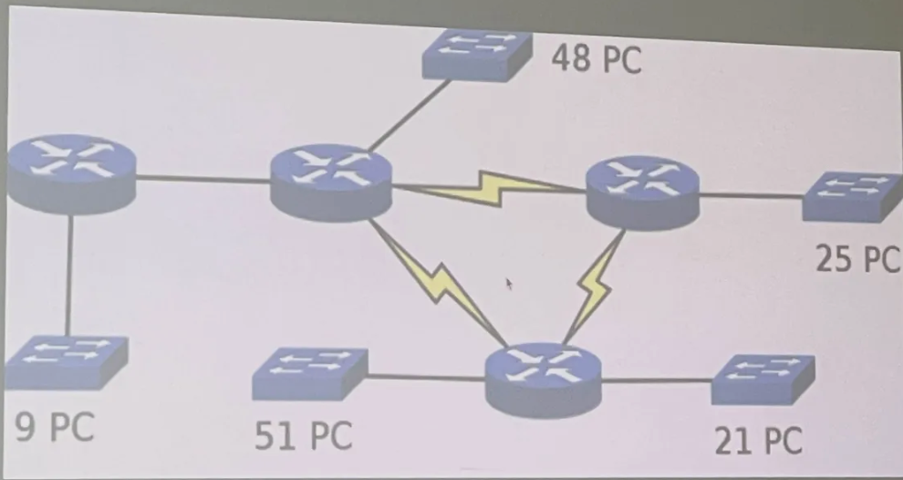
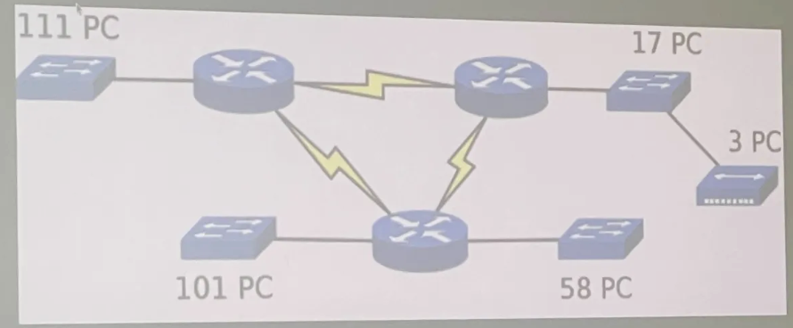

# Cvičení 4: Podsíťování proměnné délky (VLSM) a statické směrování

## Tahák pro výpočet VLSM
Při rozdělování sítě se podsítě vždy řadí **od největší po nejmenší**:
1. Spočítat potřebný počet adres: `počet PC + 1 (brána na routeru) + 2 (adresa sítě a broadcast)`.
2. Zvolit nejbližší vyšší mocninu čísla 2.
3. Spoj mezi dvěma routery (linka se symbolem blesku) potřebuje vždy 2 adresy + 2 vyhrazené = 4 adresy celkem (maska `/30`).

| Požadavek na adresy | Velikost bloku | Maska (CIDR) | Použitelné stanice |
| :---: | :---: | :---: | :---: |
| do 126 stanic | 128 | /25 | 126 |
| do 62 stanic | 64 | /26 | 62 |
| do 30 stanic | 32 | /27 | 30 |
| do 14 stanic | 16 | /28 | 14 |
| do 6 stanic | 8 | /29 | 6 |
| 2 routery (P2P spoj) | 4 | /30 | 2 |

---

## 1. Úloha: Zadaný rozsah 200.0.0.0/24

### Požadavky ze schématu (seřazeno sestupně):
- Podsíť 1: 51 PC + 1 router = 52 adres -> blok 64 (/26)
- Podsíť 2: 48 PC + 1 router = 49 adres -> blok 64 (/26)
- Podsíť 3: 25 PC + 1 router = 26 adres -> blok 32 (/27)
- Podsíť 4: 21 PC + 1 router = 22 adres -> blok 32 (/27)
- Podsíť 5: 9 PC + 1 router = 10 adres -> blok 16 (/28)
- 4x P2P spoj mezi routery (blesky): 4x blok 4 (/30)

### Tabulka přidělení podsítí:

| Velikost | Adresa sítě | Maska | Rozsah pro PC/routery | Broadcast |
| :---: | :--- | :---: | :--- | :--- |
| 64 | 200.0.0.0 | /26 | 200.0.0.1 - 200.0.0.62 | 200.0.0.63 |
| 64 | 200.0.0.64 | /26 | 200.0.0.65 - 200.0.0.126 | 200.0.0.127 |
| 32 | 200.0.0.128 | /27 | 200.0.0.129 - 200.0.0.158 | 200.0.0.159 |
| 32 | 200.0.0.160 | /27 | 200.0.0.161 - 200.0.0.190 | 200.0.0.191 |
| 16 | 200.0.0.192 | /28 | 200.0.0.193 - 200.0.0.206 | 200.0.0.207 |
| 4 | 200.0.0.208 | /30 | 200.0.0.209 - 200.0.0.210 | 200.0.0.211 |
| 4 | 200.0.0.212 | /30 | 200.0.0.213 - 200.0.0.214 | 200.0.0.215 |
| 4 | 200.0.0.216 | /30 | 200.0.0.217 - 200.0.0.218 | 200.0.0.219 |
| 4 | 200.0.0.220 | /30 | 200.0.0.221 - 200.0.0.222 | 200.0.0.223 |

---

## 2. Úloha: Zadaný rozsah 150.0.64.0/22

### Požadavky ze schématu (seřazeno sestupně):
- Podsíť 1: 111 PC + 1 router = 112 adres -> blok 128 (/25)
- Podsíť 2: 101 PC + 1 router = 102 adres -> blok 128 (/25)
- Podsíť 3: 58 PC + 1 router = 59 adres -> blok 64 (/26)
- Podsíť 4: 17 PC + 3 PC (připojené přes hub do stejné sítě) = 20 PC + 1 router = 21 adres -> blok 32 (/27)
- 3x P2P spoj mezi routery (blesky): 3x blok 4 (/30)

### Tabulka přidělení podsítí:

| Velikost | Adresa sítě | Maska | Rozsah pro PC/routery | Broadcast |
| :---: | :--- | :---: | :--- | :--- |
| 128 | 150.0.64.0 | /25 | 150.0.64.1 - 150.0.64.126 | 150.0.64.127 |
| 128 | 150.0.64.128 | /25 | 150.0.64.129 - 150.0.64.254 | 150.0.64.255 |
| 64 | 150.0.65.0 | /26 | 150.0.65.1 - 150.0.65.62 | 150.0.65.63 |
| 32 | 150.0.65.64 | /27 | 150.0.65.65 - 150.0.65.94 | 150.0.65.95 |
| 4 | 150.0.65.96 | /30 | 150.0.65.97 - 150.0.65.98 | 150.0.65.99 |
| 4 | 150.0.65.100 | /30 | 150.0.65.101 - 150.0.65.102 | 150.0.65.103 |
| 4 | 150.0.65.104 | /30 | 150.0.65.105 - 150.0.65.106 | 150.0.65.107 |

---

## Příprava na test: Jak poznat typ adresy (Síť / Host / Broadcast)

Zadaná IP a maska (např. `10.0.0.224/27`):
1. Zjisti velikost bloku: $32 - 27 = 5$ bitů $\rightarrow 2^5 = 32$.
2. Vytvoř násobky 32 pro poslední oktet: `0, 32, 64, 96, 128, 160, 192, 224, 256`.
3. Číslo `224` je přesný násobek 32 $\rightarrow$ je to **Adresa sítě**.
4. Číslo těsně před dalším násobkem (např. `224 + 32 - 1 = 255`) je **Broadcast**.
5. Cokoliv mezi tím (např. `225` až `254`) je **Použitelná adresa pro stanici (Host)**.